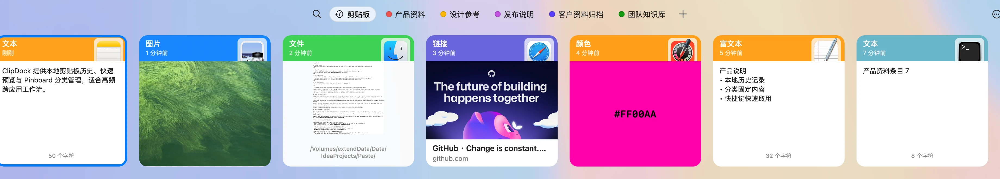
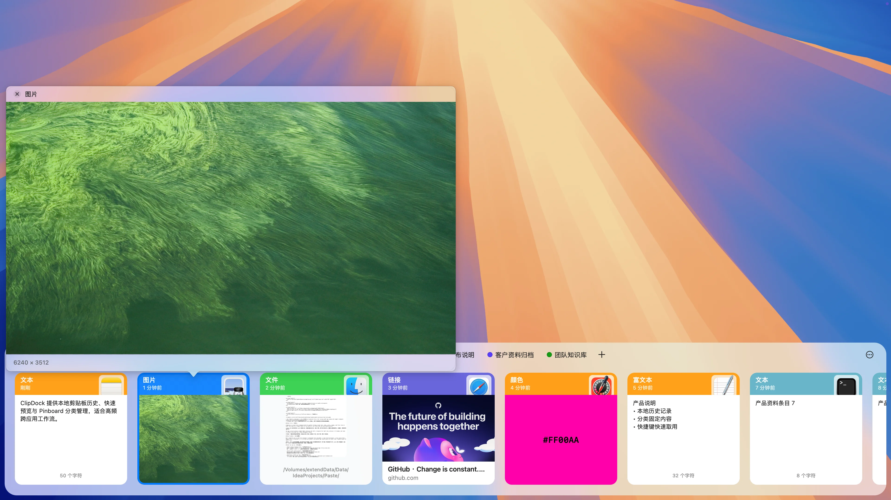
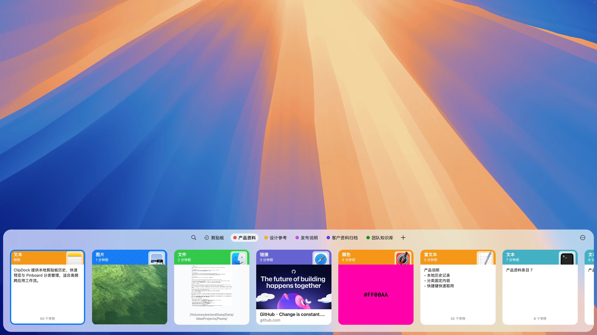
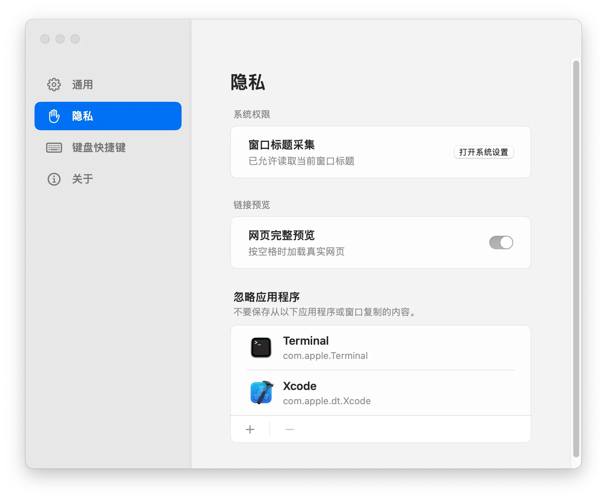
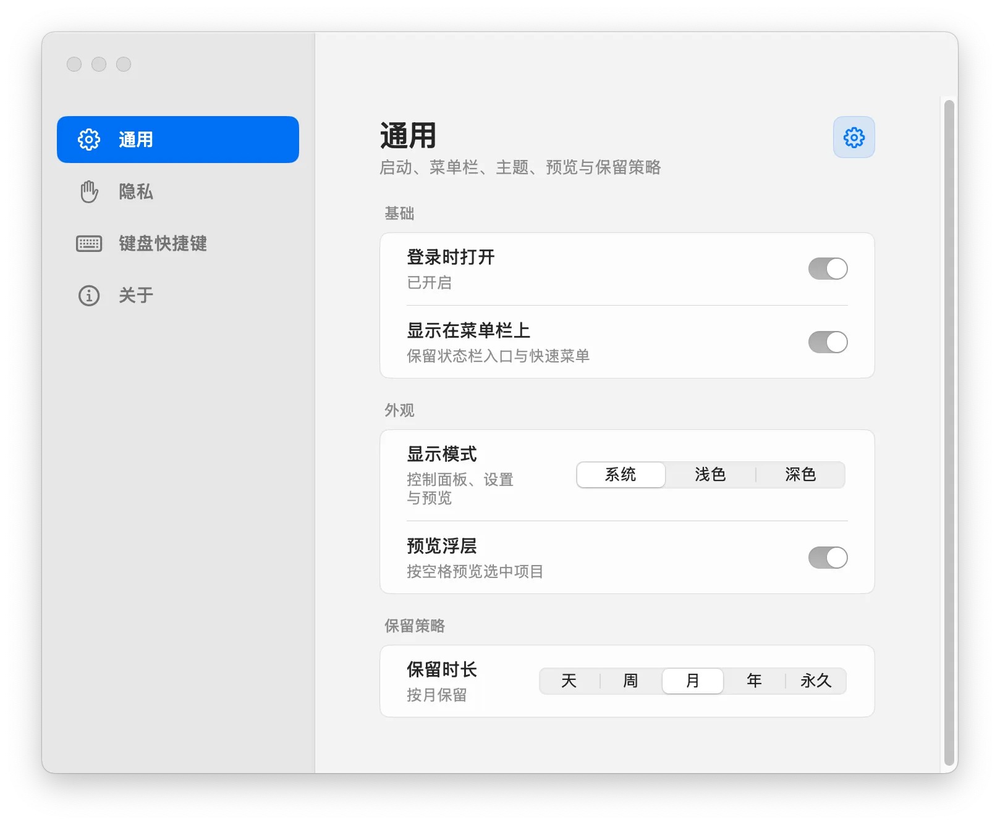

写一篇文章时，你可能先复制资料链接，再复制一段引文，接着截一张图。等到准备插入链接，才发现剪贴板里已经只剩下最后那张截图。

于是，你回到浏览器，找到原来的页面，再复制一次。等你回来，还得想一想：刚才写到哪里了？

我们开发 **ClipDock**，就是想减少这些重复翻找。它是一款本地优先的剪贴板工具，在 Mac 屏幕底部放上一排轻量卡片，让复制过的文字、链接、图片和文件留在手边，需要时找回、预览、再次使用。[了解 ClipDock](https://github.com/appdev/ClipDock)

文中配图取自项目公开的[截图素材](https://github.com/appdev/ClipDock/tree/053510c0e09f4d7e62411d3a2145fde3be381784/docs/assets/marketing)。主面板、图片预览和 Pinboard 展示的是真实运行的 macOS 应用，使用样例剪贴板数据；具体界面可能随版本调整。

## 在当前工作里找回复制记录

整理一份产品发布说明，往往要同时开着编辑器、浏览器和聊天窗口：正文在编辑器里，参考资料在网页上，同事补充的链接又在聊天记录中。这些内容复制过来，稍后还得一项项放进文档。

系统剪贴板只留着最后一次复制的内容。要找前面那条链接，往往得先想起它来自哪个应用，再回去翻页面或聊天记录。复制只是一个动作，重新找到原文却要走好几步。

在 macOS 上，按下 **Command + Shift + X**，就能呼出 ClipDock。最近复制过的内容以横向卡片呈现；记录多了，可以通过搜索定位。文字、链接、颜色、图片和文件采用不同的卡片样式，方便扫读和辨认。[查看功能介绍](https://github.com/appdev/ClipDock#它可以做什么)

图中图片直接显示画面，链接有封面和域名，颜色显示色块与色值，卡片上还保留了来源应用图标和复制时间。忘了具体文字时，也能靠这些线索辨认。

例如，整理文章时先复制几条参考链接和引文，再回到编辑器逐项取用，就不用每复制一条便切回去粘贴。需要哪一条，再从面板里找。

## 先看清内容 再决定取用

几段开头相似的文字、几张同一页面的截图，仅凭缩略内容很容易选错。

逐个粘到文档里试，选错后又要撤销；如果正在发消息，还可能把不合适的内容发出去。能找到历史记录，还得能看清每条记录的内容。

ClipDock 把预览放在取用流程里：文本可以查看完整内容，图片可以确认画面，文件提供预览，链接可以显示标题、描述和封面信息。在 macOS 面板中，选中记录后按 **Space**，就能先确认内容。[查看预览说明](https://github.com/appdev/ClipDock#预览与固定)

图中选中了图片卡片，预览浮层显示放大的画面和图片尺寸，底部的其他记录仍然可见。可以先看清图片，再决定是否取用，不必先粘到别处确认。

比如准备把截图放进文档时，先确认截取的区域对不对；引用文字前，看看被卡片截断的后半段。这样能在粘贴前发现误选，少做一次撤销和重找。

## 把常用内容固定到 Pinboard

产品介绍、项目地址、常用回复、设计参考，可能每天都要从同一个文件或同一段聊天记录里重新找出来。ClipDock 的 **Pinboard** 可以固定这些资料，让它们与不断增加的临时记录分开，需要时直接取用。[认识 Pinboard](https://clip.run.ci/#pinboard)

图中选中了“产品资料”，旁边还有“设计参考”“发布说明”等入口。常用内容有了固定位置，就不用沿着越来越长的最近记录往回翻，也不用为了保存几条片段另外维护一份文档。

准备发布内容时，可以固定产品链接和介绍；做设计时，留住常用色值和参考素材；经常回答同一类问题，也可以保存回复片段，下次取出后按具体情况修改。

## 用键盘完成常用操作

如果你习惯双手留在键盘上，ClipDock 的 macOS 面板支持方向键选择、Command + F 搜索、Space 预览和 Command + C 复制，也支持 Command + 1 到 Command + 9 快速取用可见内容。按 Esc 即可收起面板或返回。[查看键盘操作](https://github.com/appdev/ClipDock#它可以做什么)

写文档或代码时，为了取一段文字而切到另一个窗口，再用鼠标找记录，会打断正在输入的节奏。熟悉这几个按键后，呼出、选择、预览和复制都能在键盘上完成。

## 剪贴板历史保存在本机

剪贴板里可能有尚未发布的文案、工作文件，或只打算临时用一下的内容。使用历史记录工具时，除了能不能找回，也会关心它们存在哪里、哪些内容不该留下。

ClipDock 无需注册账号，剪贴板历史保存在各自的桌面设备上，不会上传进行跨设备同步。链接预览和更新检查可能访问网络。你也可以查看源码，了解它如何工作，或通过 Issue 提出建议。[了解隐私与开源说明](https://github.com/appdev/ClipDock#隐私)

隐私页提供“忽略应用程序”列表，可以排除不想保存复制内容的应用或窗口。图中用 Terminal 和 Xcode 演示这项配置，实际使用时按自己的工作内容选择。网页完整预览也有独立开关。

通用设置还能调整记录的保留时长，图中列出了天、周、月、年和永久选项。如果只想找回近期内容，可以选择较短的保留时长；同时也能设置登录时打开、菜单栏入口和显示模式。

## 开始使用 ClipDock

你可以从 [ClipDock 官网](https://clip.run.ci/) 了解产品，或前往 [GitHub Releases](https://github.com/appdev/ClipDock/releases) 获取安装包。发行页提供 macOS 的 Apple Silicon、Intel 安装包，以及 Windows 的 EXE、MSI 安装包；本文介绍的面板操作与快捷键以 macOS 为准。

在 Mac 上，将 ClipDock 放入“应用程序”，启动后按 **Command + Shift + X** 呼出剪贴坞，即可开始使用。首次打开遇到系统提示，可以参考官网的[首次打开帮助](https://clip.run.ci/open-clipdock.html)。

可以先从一次资料整理开始：连续复制几条链接和文字，再回到文档里通过面板取用。遇到之后还要用的片段，就固定到 Pinboard。

用起来有哪些不顺手的地方，欢迎到 [GitHub 仓库](https://github.com/appdev/ClipDock) 提 Issue。觉得有用，也欢迎点一颗 Star。
